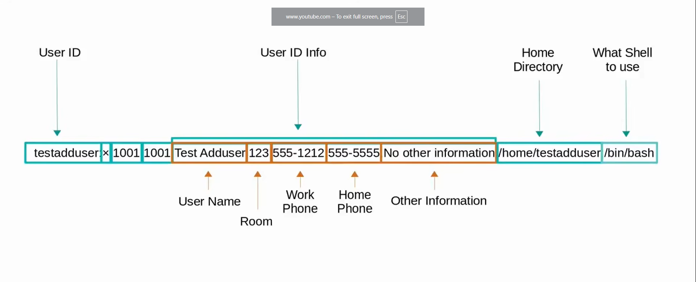
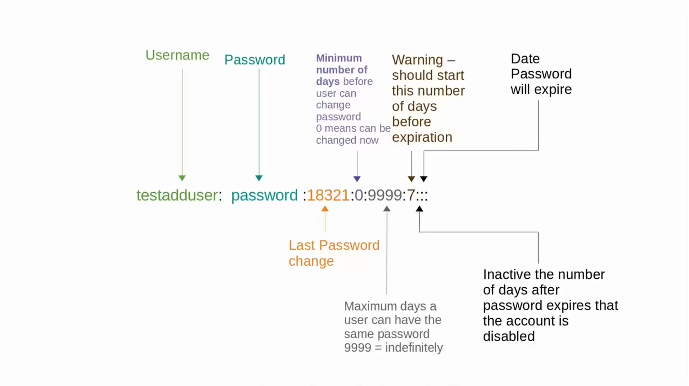

## (13) The Root user

The root user is the default privileged user
The root user has superuser or administrative (admin) privileges
The root user can change, edit, and delete any file on the file system
The root user can run any file on the file system
The root user can change permissions and create/delete accounts

```bash
$ sudo ls -lah /root
$ sudo touch /root/newfile.txt
$ sudo ls -lah /root

# If you want to kill the root privileged and go back to the normal user
$ sudo -k

# Switch to be the root user by typing
$ sudo -i

# to check the last root command from the normal user
$ sudo !!
```

---

## (14) Adding a User pt. 1

```bash

# It create a services account
# A services account is specific services that is used for to work a specific services
$ sudo adduser badhon
$ sudo passwd badhon

$ sudo useradd -m badhon118
$ sudo passwd badhon118

# In this directory we can check how many user are there
$ cd /home


# Once the user has been created we can see the user in
$ cat /etc/passwd

# to check the userid
$ id badhon118

```



---

## (15) Adding a User pt. 2

```bash
# Adding password to the user
$ sudo passwd badhon

# Check the password format
$ cat  /etc/shadow

$ sudo useradd badhon118
# badhon118:!!:20760:0:99999:7:::
# There are no password set YT.
# if ! and * are there then you can't login to the system

$ sudo passwd badhon118
$ passwd # Setting up a new password through the user

$ sudo cat  /etc/shadow
```



---

## (16) Editing Users pt. 1

```bash

# To changed the user permission or edit the user
$ chage -h

# Check the user information
$ sudo chage -l badhon

# Changed the minimum day before the user can changed it
$ sudo chage -m 14 badhon

# Expire Date
$ sudo chage -E "2026-12-12" badhon

# Check the single record for the user
$ getent passwd badhon

# Update the information in passwd file and update user permission
$ usermod -h

# update the shell in the user
$ sudo usermod -s /bin/zsh badhon

# update the user group
$ sudo usermod -d /users/testuseraddm testuseraddm


```

---

## (17) Editing Users pt. 2

```bash

# Home directory to a new location
# Change the user information or location to a new directory

# To move the user directory
$ sudo ls -lh /home
$ sudo usermod -d /users/badhon -m badhon

# Check the directory
$ su badhon
$ pwd


# Check the user directory
$ getent passwd badhon

# Changed the user name
$ sudo usermod -l badhonbiswas badhon

# Check it
$ getent passwd badhonbiswas


```
## (18) Editing users pt.3

```bash
# Add a comment in the 
# Commit : A commit is a permanent, saved snapshot of the file at a specific point of time.

# Comment : A comment is a note that is used to write inside the file.  
$ sudo usermod -c "This is a comment" badhonbiswas

# Get the user information from /etc/passwd
$ getent passwd testadduser

# Get the user information using finger
$ sudo apt install finger

# Finding information to that particular user
$ getent passwd testadduser
$ finger testadduser


# show all the available information to that particular user
$ chfn -h

# We can changed the user information using chfn
$ chfn -r 227 badhon
$ finger badhon
$ sudo chfn -f "Test User Badhon" -h "017....." -o "Other Information" badhon


# ====================================


# To force a password change for userID <userId> type:
$ passwd --expire <userId>
# OR
$ sudo chage --lastday 1970-01-01 <userId>
# OR
$ sudo chage --lastday 0 <userId>

# <UserId> will be asked to changed their password next time they log in

```

## (19) Disable-Remove Users

```bash
# To lock a userID 
$ sudo usermod -L <UserID>
$ sudo passwd -l <UserID>

# To check the User Status
$ sudo passwd -S <User_Id>

# To unlock the UserAccount
$ sudo usermod -U <User_Id>

# To again check the User Status
$ sudo passwd -S <User_Id>

# To change the shell in the user
$ sudo usermod -s /bin/nologin <User_Id>

# Another way to lock a user
$ user chage -E0 <User_Id>

# To reset/disable password aging set:
# Minimum Password Age to 0
# Maximum Password Age to 99999
# Password Inactive to -1
# Account Expiration Date to -1
# Interactive mode command:

$ chage -l -1 -m 0 -M 99999 -E -1 <userId>
# or 
$ sudo chage <userId>

# To delete a user
$ sudo userdel <User_ID>

```