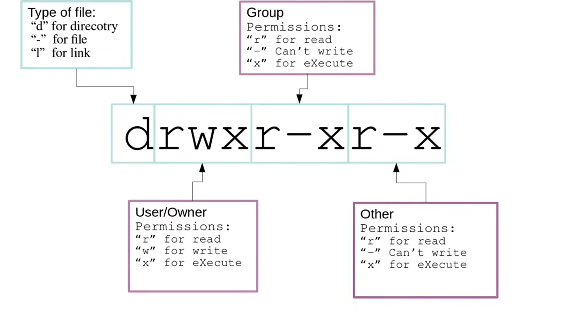

# Permissions & Groups: Understanding file permissions, ownership, groups, ACLs, and file attributes

## (21) File and Directory Permissions

The permission column is broken up into four sections

1.  _Type of file:_
    - "d" for directory
    - "-" for file
    - "I" for Link

2.  _User/Owner Permissions_
    - "r" for read
    - "w" for write
    - "x" for execute

3.  _Group Permissions:_
    - "r" for read
    - "-" Can't write
    - "x" for execute

4.  _Other Permission:_
    - "r" for read
    - "-" Can't write
    - "x" for execute



```bash
# Change the File Permission
$ chmod 777 file1.txt

# Read        Write       Execute         No Privilege
#   4           2             1               0

# The Read Privilege has a value of 4
# The Write Privilege has a value of 2
# The execute Privilege has value of 1
# No Privilege has a value of 0
```

## (22) File OwnersShip (chgrp)

<!-- Permissions & Groups: Understanding file permissions, ownership, groups, ACLs, and file attributes -->

_What is chgrp?_
Well 'chgrp' stands for change group, and its a command in Linux that allows you to modify the group ownership of files and directories. It as important tool for managing permissions and ensuring the right users have access to the files

```bash

# Syntax:
# chgrp [option].. [GROUP_NAME] [Directory/FILE_NAME]....

# Change the Group OwnerShip ec2-user
$ sudo touch file1.txt
$ sudo chgrp badhon file1.txt

# To find what group my userid has
$ groups

# If we want to what group of the user is
$ groups badhon

#

```

## (23) Groups Part 2

```bash
# Check the Sudo Group and check the Privilege user
# if its a aws Linux then
$ getent group sudo
$ getent group Wheel

# Create a new Group
$ sudo groupadd team
$ sudo groupadd deleteme


# Check the Group User
$ getent group <GroupName>
$ getent group team
$ getent group deleteme


# Delete Group
$ sudo groupdel deleteme

# Change the group name devops to devsecops
$ sudo groupadd devops
$ getent group devops
$ sudo groupmod --new-name devsecops devops
$ sudo groupmod --new-name <Group New Name> <Group Name>


# Display the groups
$ cat /etc/group

# just like etc shadow group we have group shadow file
$ sudo cat /etc/gshadow

# to add a group administrator in the group
$ sudo gpasswd -A <UserName> devsecops
$ sudo gpasswd -A <UserName>,<UserName> devsecops

# Adding the user in the group
$ sudo usermod -G <GroupName> <UserName>
$ sudo usermod -a -G <GroupName> <UserName>

$ sudo cat /etc/gshadow


---
# OK
# So if you want to add the administrator to a group
# 1. First You need to login to a privilege user In this case its ec2-user or root
# 2. First You need to a Privilege User
# 3. Its better to give a group administrator to make privilege user
$ sudo adduser badhon
$ sudo passwd badhon
$ sudo usermod -a -G wheel badhon

# Create a Group
$ sudo groupadd devops
$ sudo gpasswd -A badhon devops

# Now if you want to add user services user
$ sudo adduser biswas
$ sudo passwd biswas
$ sudo groupadd -a -G devops biswas

# The output will be
# badhon will be group administrator
# biswas will be services user
$ devops:!:badhon:biswas


# Check the group Information
$ cat /etc/group
$ sudo cat /etc/gpasswd

```

## (24) Groups pt2

```bash

# Group Administrator can add or delete a user in the group
# Switch to the administrator user in this case its badhon
$ su badhon

# Create a user
$ sudo adduser biswas1
$ sudo passwd biswas1

# Add the user to the Group
$ gpasswd -a biswas1 devops

# The Output will be
$ cat /etc/group
$ getent group devops
    -> devops:x:1004:biswas,biswas1

# Delete a user in the Group
$ gpasswd -d biswas1 devops

# Administrator User can also set group passwd
$ gpasswd devops

# Create a file in the root
$ sudo mkdir /srv/devops

# Change the group permission to devops
$ sudo chgrp <GroupName> <File_Name>
$ sudo chgrp devops devops

# Give only the permission for the group and the root user
$ sudo chmod 770 devops


```

## (25) setuid

setuid is a permissions bit flag, when the setuid bit flag is set, it allows the users to run an executable with the permissions of the file owner

```bash


```
