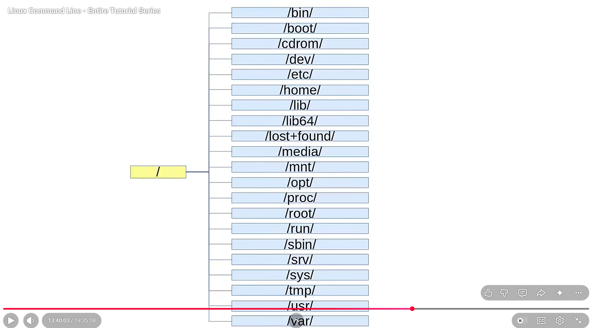

## df

The df command in linux is used to slow the disk usage information. Df is stand for disk free.
df display the amount of disk space of the file system containing each file name arguments, if no file name is given then it will show the available on all current mounted file systems is shown

_Syntax_

```bash
df [option] [File]

-a : --all = Include  pseudo, duplicate and inaccessible file system.
-B : --block-size=SIZE = Scale Sizes by SIZE before printing them
-h : --human-readable = Print size in power of 1024
-H : --si = Print size in power of 1000
-i : --inodes = List inode information instate of block size
-k : - = Like --block-size=1K
-l : --local = Limit listing of local file system
-p : --portability = Use the POSIX output format
-t : --type=TYPE = Limit listing to file system of type TYPE
-T : --print-type = Print file system type
-x : --exclude-type=TYPE = Limit listing to file systems of type TYPE
-v : Ignored; Include for compatibility reasons

# Show Available disk space Action
$ df

# Show available disk space in human-readable form Action
$ df -h

# Show available disk space for the specific file system Action
$ df -hT File_System_Name

# Show Available inode Action
$ df -i

# Show file system type Action
$ df -T

# Exclude file system type from the output action
$ df -c File_System_Name

# ===============================================
# ===============================================
# ===============================================

$ df
# Filesystem      Size  Used Avail Use% Mounted on
# tmpfs           387M  1.5M  386M   1% /run
# /dev/sda3        20G  9.5G  8.6G  53% /
# tmpfs           1.9G     0  1.9G   0% /dev/shm
# tmpfs           5.0M  8.0K  5.0M   1% /run/lock
# /dev/sda2       512M  6.2M  506M   2% /boot/efi
# tmpfs           387M  220K  387M   1% /run/user/1000

# tmpfs : tmpfs stand for temporary file system


# To see the total
$ df -h --total

# If we don't want to include the a specific file system in the output
$ df -x tmpfs

# To print a specific version of file system
$ df -T /dev/sda2
$ df /dev/sdb2

# To print out the boot file system
# in mint the default file system is /dev/sba3
$ df /
$ df -h /

# To include multiple file system
$ df -h / /dev/sda2

# Include total
$ df -h / --total
```

## du

To see file and directory size usage we can use du. du stand for disk usages

```bash
# To see file in a system
$ du

# To see all hidden file in a system
$ du -ah

# Why?
# Because Linux file system allocated storage in block. A common block size is 4096 bytes.
# Important distinction

# Command
$ touch file1.txt

# Actual File Size (logical Size)
$ ls -lh file1.txt

# Disk space Actually allocated
$ du -h file1.txt

# it will show the 4kb
$ du -ah | grep file1.txt

# For total
# -c = Total
# --total = Total
$ du -ah File1.txt -c
$ du -ah File1.txt --total

# For summarize
$ du -sh /home/badhon
$ du -sh ~/
$ du -sh

# For Home Directory
$ sudo du -sh /home/* | sort -h
$ sudo du -sh /home/* | sort -rh

# NCDU = NCurses Disk Usage
# ncud is an interactive terminal utils for analyzing disk space usage on linux

$ sudo apt install ncdu
```

## Linux File System Hierachy Standard



```bash
# bin 
# bin is short for binary
# The bin directory stores the binary for commands standers users use regularly.
$ cd /
$ ls /bin

# sbin
# The command is for sbin directory are more for disk management adn rebooting
$ which fdisk
$ which parted
$ which reboot

# lib
# the lib directory is short for library. So the lib directory is shared library files

# usr
# Unix System Resources. Linux follows most or the Unix standards and this directory name si one of them 

# boot
# The boot directory contain all the boot loader file to boot up the system including the kernel and the initial ram files that sim link file 

# cdrom
# cdrom is a legacy mount point for a cd Rom

# dev
# dev directory is the location for device files. in linux everything is a file so even when we connect a physical or virtual hard drive or a webcam, a mouse, a keyboard. Linux created a file for that devices and place the devices in the dev directory
$ ls -lh /dev | grep sda

# etc = Etsy Directory
# The Etc directory is a place for system wide configuration files
$ cat /etc/ssh/sshd_config
$ cat /etc/passwd

# home


```
